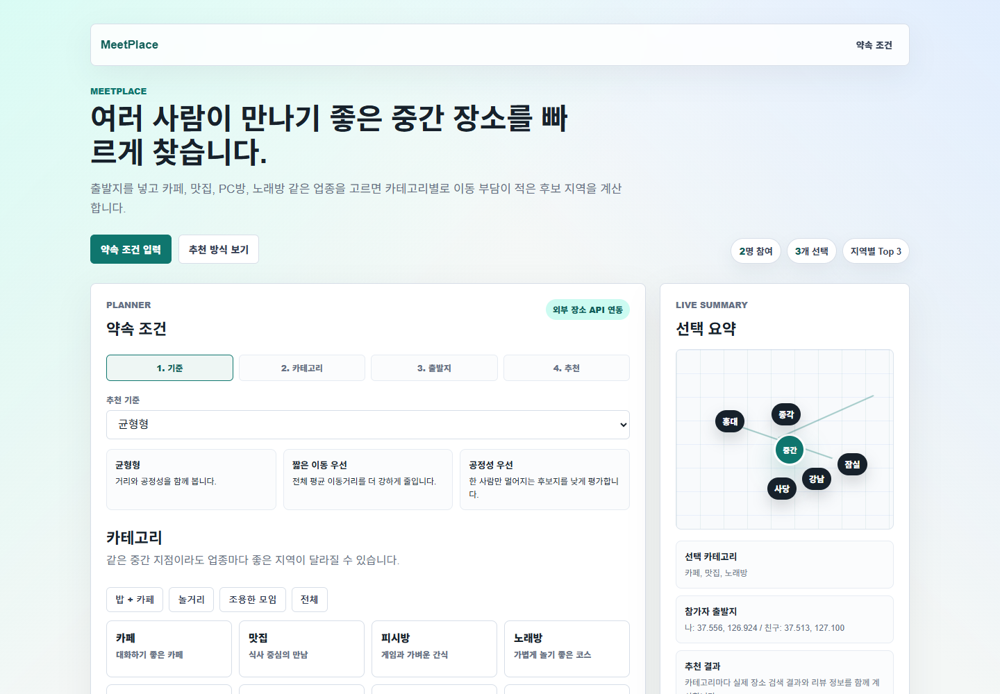
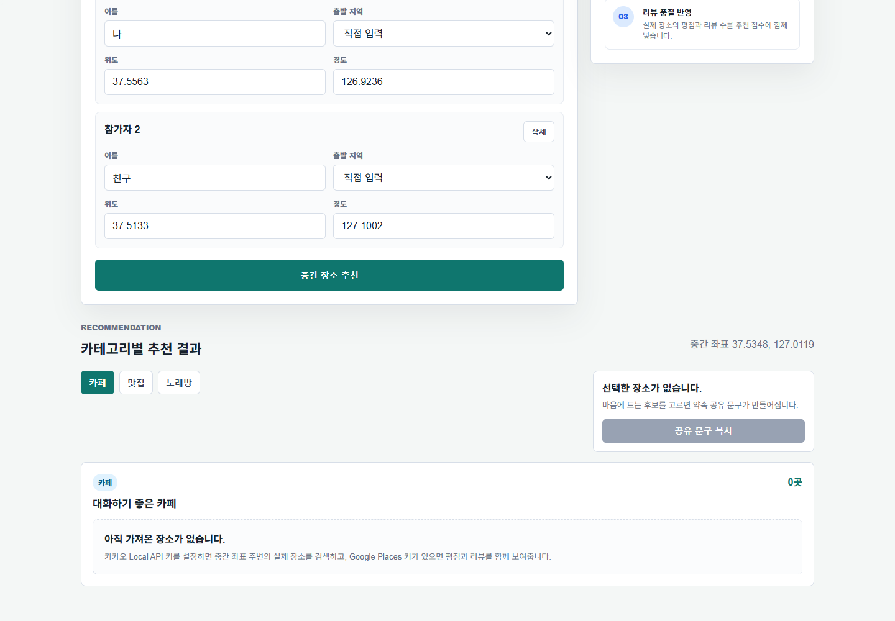

# MeetPlace

MeetPlace는 여러 명이 만날 때 각자의 출발지를 기준으로 이동 부담이 적은 실제 약속 장소를 추천하는 Spring Boot 웹 서비스입니다.

단순히 고정된 중간 지역을 보여주는 것이 아니라, 참가자들의 중간 좌표를 계산한 뒤 Kakao Local API로 주변 실제 장소를 검색하고, Google Places API의 평점과 리뷰 정보를 함께 반영해 카테고리별 추천 후보를 제공합니다.

## 화면 미리보기

### 약속 조건 입력

참가자 출발지, 추천 기준, 장소 카테고리를 한 화면에서 입력할 수 있습니다.



### 카테고리별 추천 결과

추천 결과에서는 카테고리별 후보, 중간 좌표, 공유 문구 생성 영역을 확인할 수 있습니다.



## 주요 기능

- 참가자 2명부터 8명까지 출발 좌표 입력
- 카페, 맛집, PC방, 노래방, 술집, 스터디룸, 영화관, 볼링장 등 여러 카테고리 선택
- 선택한 카테고리별 실제 장소 Top 3 추천
- 평균 이동거리, 최대 이동거리, 거리 편차, 예상 이동시간, 공정성 표시
- 추천 기준 선택: 균형형, 짧은 이동 우선, 공정성 우선
- Kakao Local API 기반 장소 검색
- Google Places API 기반 평점, 리뷰 수, 대표 리뷰 문구 보강
- 추천 후보 선택 후 약속 공유 문구 생성
- 카테고리 탭, 거리 비교 바, 리뷰 카드, 지도 링크 제공

## 화면 흐름

1. 추천 기준을 선택합니다.
2. 원하는 장소 카테고리를 고릅니다.
3. 참가자별 출발 지역을 프리셋으로 선택하거나 위도와 경도를 직접 입력합니다.
4. 추천 버튼을 누르면 중간 좌표 주변의 실제 장소를 API로 검색합니다.
5. 결과 탭에서 카테고리를 바꿔 보며 후보를 비교합니다.
6. 마음에 드는 후보를 선택하면 공유 문구가 만들어집니다.

## 추천 방식

MeetPlace는 참가자들의 출발 좌표를 기준으로 중심 좌표를 계산하고, 외부 API에서 가져온 실제 장소를 점수화합니다.

- 평균 이동거리: 전체 참가자가 평균적으로 얼마나 이동해야 하는지
- 최대 이동거리: 가장 멀리 이동하는 참가자의 부담
- 거리 편차: 참가자 간 이동거리 차이
- 중심 좌표 거리: 계산된 중간 좌표와 실제 장소의 차이
- 리뷰 신뢰도: 평점과 리뷰 수가 충분한 장소인지

선택한 추천 기준에 따라 거리와 공정성 가중치를 다르게 적용하고, 평점과 리뷰 수를 보너스 점수로 반영합니다.

## 외부 API 설정

API 키는 코드에 직접 넣지 않고 환경 변수로 설정합니다.

```bash
KAKAO_REST_API_KEY=카카오_REST_API_키
GOOGLE_PLACES_API_KEY=구글_Places_API_키
```

카카오 키가 있으면 중간 좌표 주변의 실제 장소를 검색합니다. 구글 키가 있으면 검색된 장소를 다시 매칭해 평점, 리뷰 수, 대표 리뷰 문구를 보강합니다.

## 실행

```bash
./gradlew bootRun
```

Windows에서는 다음 명령을 사용할 수 있습니다.

```bash
gradlew.bat bootRun
```

브라우저에서 `http://localhost:8081`으로 접속합니다.

## 주요 구조

```text
src/main/java/com/boclair/meetplace
├─ controller
│  └─ HomeController.java
├─ domain
│  ├─ PlaceCategory.java
│  └─ RecommendationMode.java
├─ dto
│  ├─ CategoryRecommendation.java
│  ├─ ParticipantRequest.java
│  ├─ PlaceRecommendation.java
│  ├─ RecommendationRequest.java
│  └─ RecommendationResult.java
└─ service
   ├─ ExternalPlaceSearchClient.java
   ├─ PlaceSearchClient.java
   ├─ DistanceCalculator.java
   └─ MeetingPlaceRecommendationService.java
```

## 이후 확장 방향

- Naver 지역 검색 API 보조 연동
- 지도 SDK를 붙여 후보 장소와 참가자 출발지를 지도 위에 표시
- 대중교통, 도보, 차량 기준 예상 이동시간 계산
- 사용자 로그인 후 즐겨찾기 장소와 최근 약속 기록 저장
- 실제 매장 영업 여부, 혼잡도, 가격대 반영

<!-- openui-release:start -->
## UI 작업과 검증 (2026-10-18)

여러 출발지의 중간 약속 장소 찾기: 참가자의 출발지와 만날 업종을 정해 이동 부담을 비교하고 후보 지역 확인.
기존 스택과 API·인증·라우팅을 유지하면서 읽기 쉬운 로컬 약속 플래너, 기존 지도와 녹색 시각 언어 유지 방향으로 제목·본문·CTA·간격과 모바일 배치를 다듬었습니다.
구체적인 근거, 토큰, 수정 경로와 OpenUI 입력은 [design.md](design.md)에 있습니다.

- 빌드: `Gradle 8.14.3 test bootJar (JDK 17)` 통과.
- 브라우저: 로컬 1440×900, 768×1024, 390×844, 360×800. 4크기 직접 검토, 폼·타입·CTA 가로 넘침 없음
- 기능·키보드: 실제 Spring 서버에서 참가자 추가와 POST /recommend 확인; 좌표 계산 성공, 외부 장소 키 미설정 empty 안내 확인
- 이번 변경에서 새로운 이용자 수·성과·고객 후기·공식 API 응답을 추가하지 않았습니다.

기존·신규 UI 작업에는 [AGENTS.md](AGENTS.md)의 조사 → design.md → 구현 → PC·모바일·키보드 검증 순서를 적용합니다.
OpenUI 원본은 [IamJimtheFish/openui](https://github.com/IamJimtheFish/openui), 이 저장소의 휴대 가능한 스킬은 `.agents/skills/openui/SKILL.md`입니다.
실행·환경변수·외부 API 설정은 이 README의 기존 절차를 따릅니다. 실제 비밀값은 커밋하지 않습니다.
<!-- openui-release:end -->
